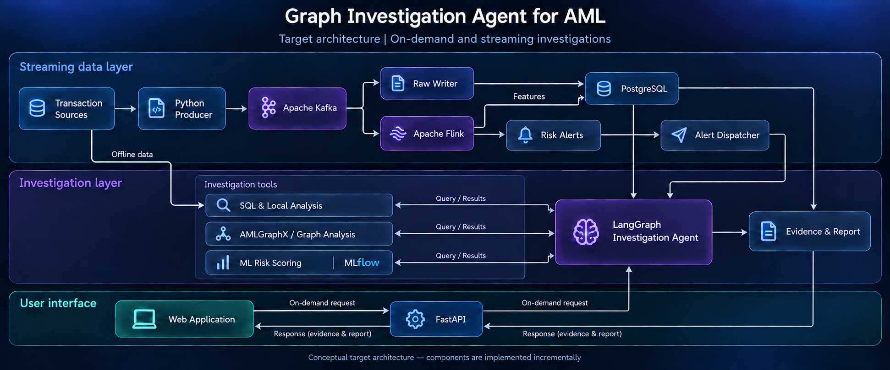

# Graph Investigation Agent for AML

An evidence-grounded investigation prototype for transaction monitoring and temporal graph analysis. Analytical tools compute findings; the LangGraph Agent chooses bounded investigative steps. An indicator is not proof of financial crime.

## Current capabilities

- Replay IBM AML CSV transactions through Kafka; archive raw events and duplicate conflicts in PostgreSQL.
- Compute hourly account features and illustrative alerts with Flink. The web UI shows each alert's triggering transaction and lets an analyst choose the sender or recipient for investigation.
- Query account transactions and investigate bounded graph neighborhoods, fan-in/out, reciprocal flows, cycles and chronological paths. On-demand investigation works with Kafka and Flink stopped.
- Run an experimental LangGraph investigation through the CLI or manually from an alert. Evidence includes transaction references and limitations.

Trained ML scoring, durable case management, automatic alert dispatch, production graph views and MLflow integration remain planned. The graph preview is explicitly synthetic. See the [Agent guide](investigation/AGENT.md) and [investigation tools](investigation/README.md).

## Architecture

[](image/aml-investigation-architecture.png)

The diagram includes planned components as well as the current implementation.

## Graph and temporal features

The investigation tools expand a bounded NetworkX directed multigraph for the selected account and time window. An account is a node and each transaction is a directed edge; parallel transfers remain separate and retain their IDs, timestamps, amounts and currencies. The following features describe the **returned subgraph**, not necessarily the entire transaction history.

| Graph feature | How it is calculated |
| --- | --- |
| Incoming / outgoing transaction count | Count edges entering / leaving the target account. Parallel transactions count separately; a self-transfer counts once in each direction. |
| Incoming / outgoing neighbors | Count distinct sender / receiver accounts connected to the target, excluding the target itself. |
| Mutual neighbors | Count distinct accounts in both the incoming and outgoing neighbor sets, excluding the target. |
| Incoming / outgoing amount | Sum amounts on incoming / outgoing edges by currency: incoming uses the received amount and receiving currency; outgoing uses the paid amount and payment currency. No currency conversion is performed. |
| Fan-in / fan-out | Compare the number of distinct external senders / receivers with `min_counterparties` (default: 2). The result also includes the counterparties and supporting transactions. |

For example, if B sends A two transactions, C sends A one, and A sends B one, A has three incoming transactions, two incoming neighbors, one outgoing neighbor and one mutual neighbor (B). If A also transfers to itself, both transaction counts increase by one, but the external neighbor counts stay the same.

| Temporal pattern | How it is calculated |
| --- | --- |
| Reciprocal flow | Pair an incoming and outgoing transaction involving the same external counterparty when the absolute time difference is within the configured limit (default: 24 hours). Either direction can occur first. |
| Rapid pass-through | Pair an incoming transaction with a subsequent outgoing transaction when `0 ≤ outgoing time − incoming time ≤ max_delay` (default: 1 hour). Same-timestamp order is uncertain. |
| Directed cycle | Search for a short directed loop containing the target (default: up to 3 edges). Rotate the transaction sequence to check chronological order and adjacent time gaps (default: 24 hours); report structural cycles even when their timing is not feasible. |
| Temporal path | Search simple outgoing paths from the target with at least two transactions (default: up to 3 edges). Each next transaction must occur no earlier than the previous one and within the configured gap (default: 24 hours). |

Pairs and paths include transaction evidence and compare adjacent amounts only when the incoming receiving currency matches the outgoing payment currency. Equal timestamps do not establish order. Graph expansion and searches have node, edge, hop, result and search limits; truncation is reported, so missing results from a truncated search are inconclusive. A connection or temporal match does not prove that the same funds moved or that a crime occurred. See the [investigation tools guide](investigation/README.md) for details.

Flink computes a separate set of **hourly event-time aggregates** by dataset, account and currency:

| Streaming feature | How it is calculated |
| --- | --- |
| Incoming / outgoing count and amount | Count incoming / outgoing movements and sum their received / paid amounts in the corresponding currency. Self-transfers contribute in both directions. |
| Net inflow | Incoming amount minus outgoing amount for the same account, currency and window. |
| Fan-in / fan-out | Count distinct external senders / receivers in the window, excluding self-transfers. |

## Run the streaming demo

With Docker Desktop running, place the IBM CSV at `dataset/LI-Small/LI-Small_Trans.csv`, then run:

```bash
docker compose up -d --build --wait raw-writer kafka-ui flink-jobmanager flink-taskmanager api frontend
docker compose exec -T postgres psql -v ON_ERROR_STOP=1 -U aml_user -d aml_db < flink/schema.sql
docker compose run --rm flink-submit
docker compose run --rm producer \
  --file /dataset/LI-Small/LI-Small_Trans.csv \
  --bootstrap-servers kafka:29092 --sort-event-time --rate 500 --limit 5000
```

Open [monitoring](http://localhost:3000), [Kafka UI](http://localhost:8080) or [Flink UI](http://localhost:8081). Set `DS_key` in the root `.env` for analyst-initiated investigations. The rules use illustrative thresholds; event-time windows, replay and reset instructions are in the [streaming guide](streaming/README.md).

Run `docker compose stop` to stop services while preserving their data in `volume/`. To run the frontend alone, use `docker compose up -d --build --wait frontend`; see the [frontend guide](frontend/README.md) for local development.

## On-demand investigation

Configure `PGHOST`, `PGPORT`, `PGDATABASE`, `PGUSER`, `PGPASSWORD` and `DS_key`, then use existing account identifiers and a half-open event-time range:

```bash
uv run python -m graph_investigation_agent_for_aml.agent.cli \
  --dataset your_dataset --bank your_bank --account your_account \
  --start 2022-09-01T00:00:00 --end 2022-09-02T00:00:00 \
  --question "Investigate unusual fund movement" \
  --format markdown --output report.md
```

The [Agent guide](investigation/AGENT.md) covers budgets and output. Streaming results may be revised for eligible late events; very late events are recorded separately. Flink deduplication state grows with unique IDs, and the pipeline does not claim end-to-end exactly-once delivery.

## Layout

`src/` contains the Python producer, persistence, investigation tools, Agent and API; `flink/` contains streaming jobs and schema; `frontend/` contains the Next.js application; `scripts/` contains the development reset utility.
