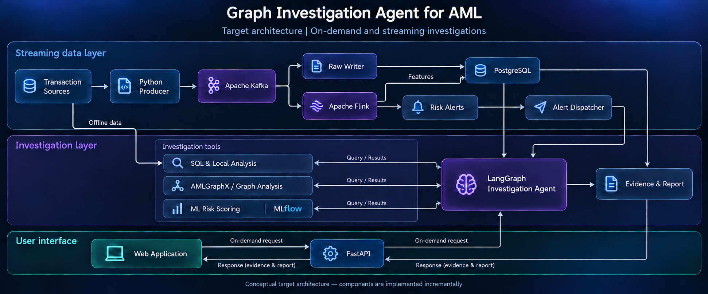

# Graph Investigation Agent for AML

An evidence-grounded investigation prototype for transaction monitoring and temporal graph analysis. Analytical tools compute findings; the LangGraph Agent chooses bounded investigative steps. An indicator is not proof of financial crime.

## Current capabilities

- Replay IBM AML CSV transactions through Kafka; archive raw events and duplicate conflicts in PostgreSQL.
- Compute hourly account features and illustrative alerts with Flink. The web UI shows each alert's triggering transaction and lets an analyst choose the sender or recipient for investigation.
- Query account transactions and investigate bounded graph neighborhoods, fan-in/out, reciprocal flows, cycles and chronological paths. On-demand investigation works with Kafka and Flink stopped.
- Run an experimental LangGraph investigation through the CLI or manually from an alert. Evidence includes transaction references and limitations.

## Quickstart

With Docker Desktop running, place the IBM CSV at `dataset/LI-Small/LI-Small_Trans.csv`, then run:

```bash
docker compose up -d --build --wait raw-writer kafka-ui flink-jobmanager flink-taskmanager api frontend
docker compose exec -T postgres psql -v ON_ERROR_STOP=1 -U aml_user -d aml_db < flink/schema.sql
docker compose run --rm flink-submit
docker compose run --rm producer \
  --file /dataset/LI-Small/LI-Small_Trans.csv \
  --bootstrap-servers kafka:29092 --sort-event-time --rate 500 --limit 5000
```

Open [monitoring](http://localhost:3000), [Kafka UI](http://localhost:8080) or [Flink UI](http://localhost:8081). To investigate from the alert list, set `DS_key` in the root `.env` before starting the API. Open an alert, select the sender or recipient, and run the investigation to view the saved report and its graph evidence. The rules use illustrative thresholds; event-time windows, replay and reset instructions are in the [streaming guide](streaming/README.md).

Run `docker compose stop` to stop services while preserving their data in `volume/`. To run the frontend alone, use `docker compose up -d --build --wait frontend`; see the [frontend guide](frontend/README.md) for local development.

## On-demand investigation

Configure `PGHOST`, `PGPORT`, `PGDATABASE`, `PGUSER`, `PGPASSWORD` and `DS_key`, then use existing account identifiers and a half-open event-time range:

```bash
uv run python -m graph_investigation_agent_for_aml.agent.cli \
  --dataset your_dataset --bank your_bank --account your_account \
  --start 2022-09-01T00:00:00 --end 2022-09-02T00:00:00 \
  --question "Investigate unusual fund movement" \
  --format markdown --output report.md
```

See the [Agent guide](investigation/AGENT.md) for budgets and output, and the [investigation tools guide](investigation/README.md) for graph feature definitions.

## Optional XGBoost scoring and MLflow

Train on the labeled HI-Small CSV with uv, then start the scorer after completing the database schema step in Quickstart.

```bash
uv run --extra ml python -m graph_investigation_agent_for_aml.scoring.train \
  --input dataset/HI-Small/HI-Small_Trans.csv --output dataset/models/hi-small
docker compose --profile scoring up -d --build scorer
```

Training uses HI-Small labels and time-ordered splits. The model outputs a ranking score, not a calibrated probability. The scorer uses previously archived transactions and revises scores when additional earlier transactions arrive; saved reports retain their original score snapshot. The LI-Small stream omits labels. Metrics in the generated `metrics.json` cover all held-out transactions; ranking within the rule-alert pool remains to be evaluated.

To register the trained files with an existing MLflow tracking server from the host, use the `tracking` extra.

```bash
uv run --extra tracking python -m graph_investigation_agent_for_aml.scoring.register_mlflow \
  --model-dir dataset/models/hi-small --tracking-uri http://localhost:5000
```

The scorer loads `dataset/models/hi-small/model.json` through the Compose mount and scores only archived transactions that triggered a rule alert. For the frontend Models page, set `MLFLOW_TRACKING_URI` in the root `.env` to an address reachable by the FastAPI container, such as `http://host.docker.internal:5000` for a server running on the Docker Desktop host.

## Optional investigation queue

After initializing the database schema, start the optional queue worker with `docker compose --profile dispatch up -d --build dispatcher`. Analysts choose the sender or recipient before queueing an alert. Duplicate alert and party pairs share one queue entry. The worker processes queued entries by priority, one investigation at a time; interrupted entries are marked failed for review.

## Architecture

[](image/aml-investigation-architecture.png)

The diagram includes planned components as well as the current implementation.

## Layout

`src/` contains the Python producer, persistence, investigation tools, Agent and API; `flink/` contains streaming jobs and schema; `frontend/` contains the Next.js application; `scripts/` contains the development reset utility.
