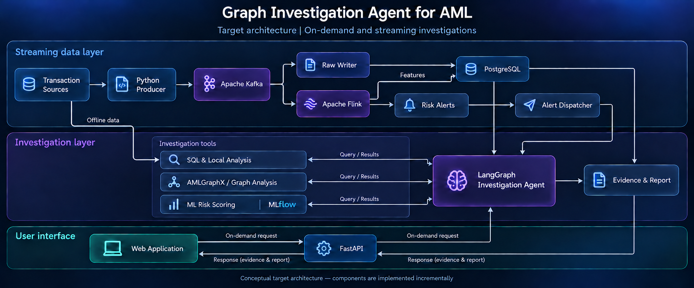

# Graph Investigation Agent for AML

An evidence-grounded financial crime investigation project combining transaction analytics, temporal graphs, machine-learning risk signals and adaptive Agent investigations.

**The Agent decides what to investigate; analytical tools compute what the data shows.** Suspicious patterns are indicators for investigation, not confirmed financial crime.

## Current status

The repository provides an IBM AML transaction replay pipeline, Kafka ingestion, PostgreSQL persistence, Flink account features and a separate web frontend foundation.

| Component | Implemented scope |
| --- | --- |
| Transaction replay | Python CSV producer, stable IDs, source provenance, configurable rate and event-time sorting |
| Persistence | Raw transactions, duplicate/conflict tracking and Kafka provenance in PostgreSQL |
| Streaming features | Hourly inflow/outflow, counts and distinct counterparties; event-time windows and late-event handling |
| Investigation queries | PostgreSQL transaction details, account summaries and counterparties with source evidence |
| Graph investigation tools | Bounded local transaction graphs, fan-in/out, reciprocal flows, cycles and temporal paths |
| Web frontend | Next.js glass shell, five route placeholders and an opt-in synthetic graph preview |
| Investigation Agent | Experimental bounded LangGraph CLI with adaptive tool selection, evidence checks and JSON/Markdown reports; FastAPI and persistent case management remain planned |
| Risk and model management | Planned: trained ML scoring, alert dispatch and MLflow integration |

The frontend is not connected to a backend API. Live monitoring, operational investigations and model metrics are not yet available. See the [investigation query guide](investigation/README.md) for query usage and evidence semantics, and the [Agent guide](investigation/AGENT.md) for the experimental CLI and its limitations.

## Target architecture

[](image/aml-investigation-architecture.png)

The diagram includes planned components. Streaming monitoring will trigger selected, bounded investigations; on-demand investigation is intended to work independently of Kafka and Flink. Numerical findings and graph paths must come from analytical tools with traceable source evidence.

## Quick start

### Frontend

With Docker Desktop running, start the frontend from the repository root:

```bash
docker compose up -d --build --wait frontend
```

Open [localhost:3000](http://localhost:3000). This starts the frontend alone. For Node 22 development and hot reload, see the [frontend guide](frontend/README.md).

### Streaming demo

Place the IBM LI Small CSV at `dataset/LI-Small/LI-Small_Trans.csv`. Datasets and local service data are ignored by Git.

```bash
docker compose up -d --build --wait raw-writer kafka-ui flink-jobmanager flink-taskmanager
docker compose exec -T postgres psql -v ON_ERROR_STOP=1 -U aml_user -d aml_db < flink/schema.sql
docker compose run --rm flink-submit
docker compose run --rm producer \
  --file /dataset/LI-Small/LI-Small_Trans.csv \
  --bootstrap-servers kafka:29092 --sort-event-time --rate 500 --limit 5000
```

Open [Kafka UI :8080](http://localhost:8080) or [Flink UI :8081](http://localhost:8081). Submit only one live feature job. Hourly results appear after event time advances past the window; a short sample may not close a window.

For replay modes, database inspection, validation, checkpoints and data resets, see the [streaming development guide](streaming/README.md) and [Flink guide](flink/README.md).

```bash
docker compose stop
```

This stops the services while keeping containers and data under `volume/`.

### On-demand investigation Agent

The experimental LangGraph CLI investigates transactions already stored in PostgreSQL. Kafka and Flink are not required for this mode. Configure the PostgreSQL connection with `PGHOST`, `PGPORT`, `PGDATABASE`, `PGUSER` and `PGPASSWORD`, and put the DeepSeek API key in the root `.env` as `DS_key`.

```bash
uv run python -m graph_investigation_agent_for_aml.agent.cli \
  --dataset your_dataset --bank your_bank --account your_account \
  --start 2022-09-01T00:00:00 --end 2022-09-02T00:00:00 \
  --question "Investigate unusual fund movement" \
  --format markdown --output report.md
```

Use identifiers and a half-open event-time range that exist in the database. The Agent chooses among bounded, predefined analysis tools; transaction findings come from the database and analytical functions. Patterns are indicators for review, not conclusions of criminal activity. See the [Agent guide](investigation/AGENT.md) for budgets, report formats, evaluation and limitations.

## Project layout

```text
frontend/       Next.js application, UI components and frontend guide
src/            Python transaction producer and raw writer
flink/          DataStream job, bounded SQL job and database schema
scripts/        Validation and development reset utilities
tests/          Python tests and synthetic streaming fixtures
streaming/      Detailed streaming operations guide
investigation/  Query, graph-analysis and Agent CLI guides
compose.yaml    Local services and on-demand replay/job submission
```

## Development roadmap

1. Expose the on-demand LangGraph investigation workflow through FastAPI and persist case state.
2. Introduce evaluated ML risk scoring and structured alerts with deduplicated dispatch.
3. Connect the frontend to implemented APIs and evaluate detection, evidence quality and investigation cost.

Current streaming features are aggregates, not proof of laundering. The demonstration retains first-seen transaction IDs in Flink state, so state grows with unique IDs; very late events are recorded separately. No end-to-end exactly-once guarantee is claimed. See the streaming guide for replay and recovery limits.
