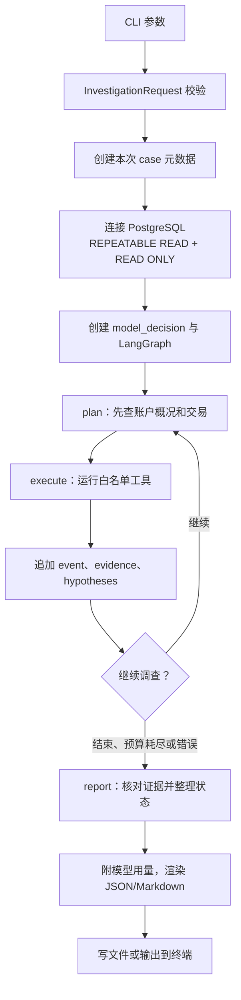

# 按需调查 CLI 数据流与代码边界

本文记录当前命令行调查的一次完整执行路径，并标出可复用的调查核心与 CLI 专属职责。实时告警已接入最小 FastAPI 和手动调查接口；案件持久化和 Agent 过程事件推送尚未实现。

## 一次调查怎样运行

1. `agent/cli.py:main` 从命令行读取 `dataset`、`bank`、`account`、`start`、`end`、`question`，可选 `as_of`、工具/时间/模型预算、模型名、对照基线和报告格式。`InvestigationRequest` 在联系数据库和模型前校验必填字段、账户字符串、起止时间顺序及时间区语义：事件时间必须是来源本地的无时区时间，`as_of` 必须带时区。
2. CLI 从参数创建本次案件字典，包含 `case_id`、`trigger=on_demand` 和 `created_at`；读取 DeepSeek key，建立 PostgreSQL 连接，并设为只读的 `REPEATABLE READ` 快照。这样一轮调查的账户统计、交易和图证据来自同一数据库快照。
3. CLI 创建模型决策适配器 `model_decision`，并调用 `build_graph(...).invoke(...)`。初始 `InvestigationState` 放入案件、空的 `events` 和 `evidence`，以及空的 `graph_data`。模型不是自由执行 SQL 的 Agent；它只从当前可用的固定工具名中选择下一步。
4. `plan` 先强制执行 `get_account_profile` 和 `get_transactions`。之后才把案件、真实工具证据、已检查的假设、可用动作和剩余时间交给模型。模型决策通过 `ModelDecision` 校验；重复动作、不可用动作、工具数、模型请求数和时间均受程序限制。
5. `execute` 按固定目标、数据集和时间范围分派工具。账户统计与交易查询来自 `investigation.py`；扩图及 fan-in/out、快速转出、环路、路径等图分析来自 `graph_investigation.py`。图分析必须先扩图；扩图、查询和数据库语句均有上限。
6. 每次工具执行会追加一条 `event`，记录动作、目的、时间和完成/失败状态；结构化工具结果独立追加到 `evidence`。图数据和证据保留在 LangGraph state；执行后根据已核验结果更新假设，再回到 `plan`。预算耗尽、模型/工具错误或模型选择结束时进入报告节点。
7. `build_report` 从证据生成确定性摘要，核对图发现中的交易 ID、时间、方向和金额与扩图原始行的一致性，并校验快速转出/双向交易的时间差和币种金额比较。报告区分 `indicator_observed`、`indicator_not_observed`、`inconclusive` 和 `not_examined`，并保留证据、事件、校验错误、停止原因、局限和后续调查建议。
8. CLI 最后附加模型名和供应商返回的 token 用量，渲染 JSON 或 Markdown，写入指定文件或打印到终端。退出码 `0` 表示正常结束，`1` 表示模型/工具/证据校验错误，`2` 表示调查未正常完成（例如达到预算上限）；部分报告仍会输出。

## 现有代码映射

| 职责 | 当前实现 | 可复用内容 |
| --- | --- | --- |
| 请求与模型决策校验 | `agent/models.py` | `InvestigationRequest`、`ModelDecision`；API 可复用请求规则，再由 HTTP schema 映射。 |
| 调查状态与循环 | `agent/state.py`、`agent/graph.py` | `InvestigationState`、`build_graph(connection, decide, ...)`；核心循环注入数据库连接和决策函数，不依赖 argparse。 |
| 固定工具分派 | `agent/tools.py` | `ACTIONS`、`execute(...)`；LLM 只能调用预先定义的分析函数。 |
| SQL 账户/交易证据 | `investigation.py` | `get_account_profile`、`get_transactions`、`get_counterparties`；结果带查询范围、来源、时间、版本和限制信息。交易列白名单排除 `is_laundering` 与带标签的 `raw_event`。 |
| 图与时间分析 | `graph_investigation.py` | `expand_transaction_graph` 和各模式检测；负责有界计算与交易级证据。 |
| 证据核验与报告 | `agent/report.py` | `build_report`、`render_report`；报告事实来自工具结果，不由模型改写为新的数值或交易。 |
| 命令行适配 | `agent/cli.py` | `main`、`load_key`、`model_decision`、输出文件/终端和退出码；这些属于当前 CLI 入口或 DeepSeek 适配器，不是调查规则本身。 |

## CLI 与未来 API 的边界

- **已有、可复用的调查核心：** 参数/决策模型、`build_graph`、固定工具分派、SQL 查询、图分析和报告构建。`build_graph` 已通过 `connection` 与 `decide` 注入运行依赖。
- **当前 CLI 专属部分：** argparse 取参、密钥加载、DeepSeek HTTP 请求的构造、数据库连接创建、case ID 创建、格式选择、文件/终端输出和进程退出码。现在这些职责集中在 `agent/cli.py:main`。
- **建议的复用接缝（尚未实现）：** 将 CLI 中“从已校验案件与依赖启动 LangGraph 并返回报告”的部分提取成应用服务，例如 `run_investigation(connection, case, decide, budgets) -> report`。CLI 和未来 FastAPI 都调用同一服务；两者各自负责入口参数、认证/依赖、响应格式和执行生命周期。
- **当前 API 的边界：** `api.py` 提供实时告警 SSE 和分析师选择交易付款方/收款方的同步调查接口。调查复用 `build_graph`，但尚无持久化案件状态、后台任务/重试、按案件 ID 查询或 Agent 过程事件流。最终报告中的 `events` 是一轮调查结束后返回的动作记录；告警 SSE 不是 Agent 事件流。

按需调查只要求 PostgreSQL 中有可查询的交易；Kafka 和 Flink 不在这条执行路径中。案件是当前 CLI 运行时创建的对象，调查状态和报告还没有写入业务表。
